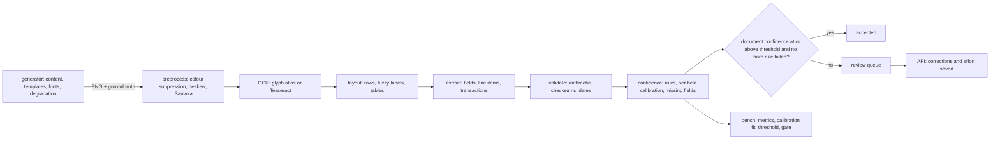

# ledgerlens

Document intelligence for finance: a seeded generator of invoices, receipts and bank
statements with exact ground truth, an offline OCR and extraction pipeline with
accounting validation rules and calibrated confidence, a benchmark that measures every
claim, and a review-queue API that records what humans had to fix.

Everything runs on a laptop CPU with no API key and no network. Python 3.13 via `uv`.

## What it does

1. **Generates documents you can score against.** Ten layouts (five invoice, three
   receipt, two bank statement templates), four seen font families plus two held-out
   faces, four locales (INR with GSTIN, GBP and EUR with IBAN, USD), three separator
   and seven date conventions. Each page is degraded with physically motivated
   defects (skew, defocus and motion blur, sensor noise, dust, vignetting, coloured
   stamps, JPEG) and shipped with its fields, line items, transactions and word boxes.
2. **Reads them back.** Colour-ink suppression, deskew, noise-adaptive binarisation,
   segmentation, a glyph-atlas OCR engine built from the generator's own fonts (or
   Tesseract when a binary is present), fuzzy label anchoring, table and till-pattern
   parsing, checksummed identifiers.
3. **Checks the record.** Totals must reconcile, items must sum, IBAN and GSTIN
   checksums must hold, balances must chain, dates must make sense. When a label is
   unreadable, the arithmetic can still identify the right printed amount. Rules move
   field confidences, a per-field calibration fitted on a labelled calibration split
   turns them into probabilities, missing expected fields are penalised, and the
   document confidence is the product. A threshold chosen on the calibration split
   decides between straight-through processing and human review.
4. **Measures it.** Field precision, recall and F1 per field, template, severity and
   font; line-item and transaction F1 (exact and with relaxed descriptions); OCR
   character error rate; the fraction of documents accepted without review and how many
   of those were correct; human effort saved under an explicit cost model; latency per
   page; a per-document results file for error analysis.
5. **Serves it.** FastAPI with typed schemas, `/health`, Prometheus `/metrics`, JSON
   logs with request ids, API-key auth, SQLite persistence, a review queue with
   corrections, and a one-page dashboard.

## Architecture



`docs/ARCHITECTURE.md` describes every module and the data flow for one page.

## Quickstart

```
cd ~/forge/ledgerlens
make setup        # uv sync and build the OCR glyph atlas (25 s from a fresh clone here)
make test         # 116 tests (35 s here)
make bench        # generate 600 pages, score them, write benchmarks/ and the table below (321 s here)
make serve        # API and dashboard on http://localhost:8000 (PORT=8001 make serve to move it)
```

Then process a page:

```
uv run ledgerlens generate --size 3 --name demo
curl -F "file=@data/synthetic/demo/demo-00000.png" http://localhost:8000/v1/documents
```

Or from the command line without the server: `uv run ledgerlens extract data/synthetic/demo/demo-00000.png`.

## Measured results

<!-- results:start -->
Measured on 2026-10-25T04:52:53+00:00 (commit 2edcfea, macOS-26.5.1-arm64-arm-64bit-Mach-O, arm64, Python 3.13.17), test split of 400 pages, calibration split of 200 pages, OCR engine `atlas`.

| Metric | Value |
|---|---|
| Documents scored (test split) | 400 |
| Document type accuracy | 97.0% |
| Field precision / recall / F1 (micro, exact match) | 81.9% / 51.9% / 63.6% |
| Line-item F1 (exact description, quantity, amount) | 31.5% |
| Transaction F1 (exact row) | 31.4% |
| Line-item F1 / transaction F1, amounts exact and description similarity at least 0.8 | 49.8% / 38.6% |
| OCR character error rate, seen fonts / unseen fonts | 23.9% / 31.8% |
| Fully correct records (all fields and rows) | 6.8% |
| Acceptance threshold (lowest with 95% header accuracy on the calibration split) | 1.0 |
| Accepted without review | 0.0% |
| Accepted documents with every header field exact | 0.0% |
| Accepted documents also exact on every line item and transaction | 0.0% |
| Human effort saved (cost model in docs/EVALUATION.md) | 41.5% |
| Latency per page, mean / p50 / p95 (ms) | 1807.2 / 1386.7 / 4337.8 |

### Per field

| Field | Precision | Recall | F1 | Support |
|---|---|---|---|---|
| closing_balance | 97.4% | 46.8% | 63.2% | 79 |
| currency | 99.3% | 71.8% | 83.3% | 400 |
| customer_name | 58.0% | 26.7% | 36.5% | 285 |
| document_date | 90.5% | 57.5% | 70.3% | 400 |
| document_number | 79.1% | 51.9% | 62.7% | 372 |
| due_date | 97.3% | 52.4% | 68.1% | 206 |
| gstin | 94.9% | 36.3% | 52.5% | 102 |
| iban | 100.0% | 34.3% | 51.1% | 105 |
| opening_balance | 97.6% | 50.6% | 66.7% | 79 |
| period_end | 100.0% | 57.0% | 72.6% | 79 |
| period_start | 100.0% | 57.0% | 72.6% | 79 |
| subtotal | 89.8% | 55.1% | 68.3% | 321 |
| tax | 89.8% | 55.1% | 68.3% | 321 |
| total | 86.9% | 53.9% | 66.5% | 321 |
| vendor_name | 47.4% | 45.5% | 46.4% | 400 |

### Per template

| Template | Docs | Field F1 | Line-item F1 | Transaction F1 |
|---|---|---|---|---|
| invoice_boxed | 35 | 57.5% | 39.4% | 0.0% |
| invoice_classic | 38 | 66.1% | 42.7% | 0.0% |
| invoice_letter | 45 | 64.5% | 43.5% | 0.0% |
| invoice_modern | 48 | 59.4% | 0.9% | 0.0% |
| invoice_tax | 40 | 62.1% | 33.5% | 0.0% |
| receipt_cafe | 33 | 64.8% | 37.9% | 0.0% |
| receipt_retail | 42 | 59.2% | 22.8% | 0.0% |
| receipt_thermal | 40 | 70.2% | 31.0% | 0.0% |
| statement_ledger | 36 | 66.3% | 0.0% | 27.3% |
| statement_ruled | 43 | 66.5% | 0.0% | 34.2% |

### Per severity

| Severity | Docs | Field F1 | OCR CER | Fully correct records |
|---|---|---|---|---|
| clean | 100 | 91.0% | 3.5% | 22.0% |
| heavy | 154 | 26.1% | 51.4% | 0.0% |
| light | 146 | 72.2% | 13.2% | 3.4% |

### Seen versus unseen fonts

| Fonts | Docs | Field F1 | OCR CER |
|---|---|---|---|
| unseen | 61 | 36.0% | 31.8% |
| seen | 339 | 68.0% | 23.9% |

### Acceptance at other thresholds (test split)

| Threshold | Accepted | Header exact | Fully exact | Accepted with a header error |
|---|---|---|---|---|
| 0.3 | 14.5% | 89.7% | 43.1% | 6 |
| 0.5 | 11.8% | 93.6% | 48.9% | 3 |
| 0.7 | 4.2% | 100.0% | 52.9% | 0 |
| 0.8 | 3.5% | 100.0% | 50.0% | 0 |
| 0.9 | 0.5% | 100.0% | 50.0% | 0 |
| 0.95 | 0.0% | 0.0% | 0.0% | 0 |
<!-- results:end -->

**OCR engine used for these numbers: the shipped glyph-atlas engine (`atlas`).** No
`tesseract` binary existed on the build machine and none could be installed without
sudo, so the fallback engine described in `docs/ARCHITECTURE.md` produced every figure
above. It is trained on the four seen font families the generator uses, which is why
the table separates seen from unseen fonts: the unseen rows are the honest measure of
generalisation, the seen rows are what a deployment with known fonts would get. A
Tesseract adapter is included and selected automatically when the binary is present
(`LEDGERLENS_OCR=tesseract` forces it); its numbers are not reported because they were
not measured here.

**How to read the acceptance rows.** The acceptance target was fixed before the final
run: accept a document without review only if, on the calibration split, at least 95%
of documents accepted at that threshold have every header field exact (and at least
five documents are accepted). On the 200-page calibration split no threshold met that
bar (at 0.5, 19 documents were accepted and 84.2% of them were exact; at 0.7, 6 were
accepted and 66.7% exact), so the shipped threshold is 1.0: nothing is auto-accepted and
every document goes to the review queue with its fields prefilled, which is where the
41.5% effort saving comes from. The "Acceptance at other thresholds" table shows what
the test split would have looked like at fixed thresholds (for example 0.7 accepts 4.2%
of documents, all with exact headers); those are test-split observations, not a
threshold chosen on them. The gap between the two splits comes from small counts at the
top of the confidence range: two confidently wrong vendor names in the calibration split
are enough to fail a 95% bar.

Definitions, the dataset mix, the seed policy, the calibration and threshold procedure
and the effort cost model are in `docs/EVALUATION.md`. `REPORT.md` records the exact
commands and outputs. `benchmarks/documents.jsonl` lists every test document with its
confidence, decision and wrong fields.

## API

| Method and path | Purpose |
|---|---|
| `GET /health` | liveness, version, engine, threshold |
| `GET /metrics` | Prometheus text format |
| `POST /v1/documents` | multipart image upload; returns the typed extraction and decision |
| `GET /v1/documents/{id}` | a stored result |
| `GET /v1/queue` | documents waiting for review, with failed rules and prefilled fields |
| `POST /v1/queue/{id}/review` | corrections; returns fields corrected, confirmed and effort saved |
| `GET /v1/stats` | counts and the measured effort saving across all reviews |
| `GET /` | dashboard (vanilla JS, no build step) |

Set `APP_API_KEY` to require `X-API-Key` on `/v1/*`. Every response carries
`X-Request-ID`, echoed from the request when provided.

## Configuration

| Variable | Default | Meaning |
|---|---|---|
| `LEDGERLENS_DATA_DIR` | `data` | atlas cache, synthetic splits, database |
| `LEDGERLENS_OCR` | `auto` | `atlas`, `tesseract`, or `auto` (Tesseract if installed) |
| `LEDGERLENS_THRESHOLD` | from `benchmarks/threshold.json`, else 0.5 | acceptance threshold |
| `LEDGERLENS_THRESHOLD_FILE` | `benchmarks/threshold.json` | threshold chosen by the benchmark |
| `LEDGERLENS_CALIBRATION_FILE` | `benchmarks/calibration.json` | per-field calibration fitted by the benchmark (identity if absent) |
| `LEDGERLENS_DB` | `data/ledgerlens.db` | SQLite path |
| `APP_API_KEY` | unset | API key required on `/v1/*` when set |
| `LEDGERLENS_LLM` | `0` | `1` enables the optional Claude second reader |
| `LEDGERLENS_LLM_MODEL` | `claude-opus-5-5` | model for the second reader (`claude-haiku-5-5` is the cheap option) |
| `LEDGERLENS_MAX_UPLOAD_BYTES` | 20 MiB | upload limit |

The optional LLM step (`uv sync --extra llm`, `LEDGERLENS_LLM=1`, credentials resolved
by the Anthropic SDK) is consulted only for documents already headed to review; it
re-reads low-confidence fields from the page image and the validation rules still make
the decision. Tests and the benchmark never use it.

## Docker

```
docker build -t ledgerlens .
docker run -p 8000:8000 ledgerlens
```

Multi-stage build, non-root user, atlas prebuilt into the image.

## Limitations

- The data is synthetic. Vocabulary, layouts, fonts and degradations are those of the
  generator; real scans have more of everything. The seen-font numbers measure the
  pipeline on documents whose fonts the OCR has templates for.
- Recall is the weak side: micro precision is 81.9% but recall 51.9% on the test split.
  Most misses are fields that were not found at all, usually because a label was
  misread. Heavy pages (blur, motion blur, JPEG, stamps) reach only 26.1% field F1 and
  51.4% character error rate; clean pages reach 91.0% and 3.5%.
- The atlas OCR is a nearest-template recogniser. It degrades sharply on heavy blur and
  on unseen faces (36.0% field F1 on unseen fonts against 68.0% on seen ones), and it
  has no language model beyond character-class smoothing.
- Names have no checksum. Vendor and customer names are the least accurate fields
  (46.4% and 36.5% F1) and the cause of most confidently wrong records, which is why no
  threshold met the 95% acceptance bar on the calibration split.
- Exact line-item matching is strict: one misread character in a description fails
  the row (31.5% exact F1, 49.8% with relaxed descriptions).
- Latency is 1.8 s per page on average on an Apple Silicon laptop core, 4.3 s at the
  95th percentile, and it varies with machine load (an earlier run of the same
  command measured 1.5 s and 3.8 s); heavy pages cost most because fused glyphs trigger the cut search.
- Receipts with tax included in prices, multi-page documents, handwriting, wrapped
  table descriptions and discounts are not generated and not handled.
- Document confidence multiplies field probabilities as if their errors were
  independent; the calibration corrects each field, not their correlation.

## Roadmap

- A learned character classifier (small CNN trained on the generator) to replace
  nearest-template matching on heavy pages.
- Line-level language model for label words.
- Multi-page statements and invoices with carried totals.
- Active learning from review corrections: queued documents with corrections become
  regression cases for the benchmark.

## Development

```
make lint     # ruff check and format check
make test     # pytest
make bench    # benchmark, writes benchmarks/
make bench-gate   # benchmark with thresholds from benchmarks/thresholds.json
```

Fonts in `src/ledgerlens/assets/fonts` are DejaVu (Bitstream Vera licence) and STIX
(SIL Open Font Licence); licences are included next to the files.
